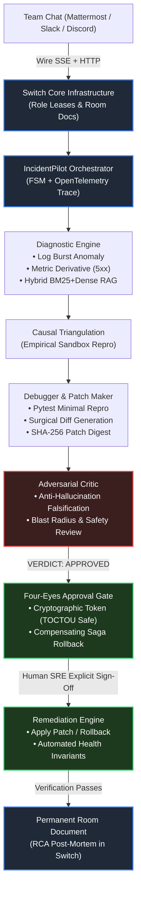

# IncidentPilot
> **Autonomous, Human-Supervised AI SRE Incident Response Platform Built Natively on Switch.**

[](https://github.com/Namanbhatt-01/incidentpilot/actions)
[](https://www.python.org/downloads/)
[](LICENSE)
[](https://docs.switchagents.ai)
[](https://github.com/Namanbhatt-01/incidentpilot)

Built for the **[Flip the Switch Hackathon](https://www.wemakedevs.org/hackathons/switch)** (Powered by **WeMakeDevs** & **DevTools Academy**).

---

## Quickstart and Live Service Ports

You can execute and evaluate the complete IncidentPilot platform locally with a single command — **no external API keys required**:

```bash
# 1. Clone repository
git clone https://github.com/Namanbhatt-01/incidentpilot.git
cd incidentpilot

# 2. Option A: Launch Live Target Service & Interactive War Room (Port 8000)
./scripts/start_demo.sh
# -> Automatically opens http://127.0.0.1:8000 (UI, Swagger, Prometheus metrics)

# 3. Option B: Interactive Terminal Simulation for Video Recording
make sim          # Live terminal war room with interactive human approval
make sim-auto     # Automated replay for continuous video recording

# 4. Option C: Real End-to-End Live HTTP SRE Drill with Google Gemini
make drill        # Sends real HTTP requests, induces chaos, and verifies recovery

# 5. Option D: Deterministic Offline Evaluation Suite (0.27s)
./quickstart.sh --offline
```

### Live Service Ports and Endpoints
| Port / Endpoint | Protocol | Description |
| :--- | :--- | :--- |
| **`http://127.0.0.1:8000/`** | HTTP | **Interactive Switch War Room Dashboard** (Live state synchronization) |
| **`http://127.0.0.1:8000/docs`** | HTTP | **FastAPI Swagger API Documentation** (OpenAPI v3 schemas) |
| **`http://127.0.0.1:8000/metrics`** | HTTP | **Prometheus Metrics Exporter** (Error rate, latency, chaos state) |
| **`http://127.0.0.1:8000/health`** | HTTP | **Microservice Health Probe** (`200 OK` vs `degraded`) |
| **`POST http://127.0.0.1:8000/orders`** | HTTP | **Transactional Order Pipeline** (Spikes to 500 during regression) |

---

## Problem Statement and Hackathon Challenge Alignment

The official hackathon challenge states:
> *"Take an AI agent you already use, Claude Code, Codex, Cursor, OpenCode and Antigravity, connect it to Slack, Teams, Discord and Telegram with Switch, and build a workflow where it gets real work done."*

### How IncidentPilot Satisfies Each Requirement:
1. **AI Agents You Already Use**:
   - Built natively for **Claude Code**, **Codex**, **Cursor**, **OpenCode**, and **Antigravity**. Configured via `params.provider` in [`incident-pilot.template.yaml`](switch/templates/incident-pilot.template.yaml).
2. **Team Communication Platforms**:
   - Connects seamlessly to **Slack**, **Microsoft Teams**, **Discord**, **Telegram**, and **Mattermost** via Switch Room Bridges (`bridge: "{$first}"`).
3. **Real Work Done (Shipped, Fixed, Reviewed)**:
   - **Detected**: Ingests real-time Prometheus error spikes and raw service exceptions.
   - **Diagnosed**: Queries 13 curated SRE runbooks using Hybrid BM25 + Dense RRF retrieval and live Google Gemini AI inference.
   - **Fixed**: Synthesizes minimal regression reproductions and generates surgical rollback/patch diffs.
   - **Reviewed**: An Adversarial Critic agent validates blast radius and backwards compatibility.
   - **Shipped**: A cryptographic HMAC-SHA256 human approval gate authorizes execution, shifting traffic to healthy targets and compiling a post-mortem into permanent room documents.

---

## System Architecture



---

## Multi-Agent Architecture and Responsibilities

| Agent Role | Switch Handle | Addressing | Responsibility |
| :--- | :--- | :--- | :--- |
| **Incident Commander** | `@sre-commander` | `anyone` | Manages incident FSM state, pins live war-boards, and coordinates human approval gates. |
| **Diagnostic SRE** | `@sre-diagnostician` | `owner-agents` | Slices container logs, queries Prometheus metrics, and retrieves SRE runbooks via Hybrid RAG. |
| **Debugging Engineer** | `@sre-debugger` | `owner-agents` | Reproduces bugs in sandbox (`orders-api`), captures failure traces, and drafts surgical diffs. |
| **Adversarial Critic** | `@sre-critic` | `owner-agents` | Red-team SRE challenging root cause grounding and screening patches for side effects. |

---

## Production SRE Safety Invariants

1. **Empirical Causal Triangulation**:
   - Diagnoses are rejected unless proven in the sandbox: the minimal reproduction test must fail against the broken service and pass with the patch applied.
2. **Cryptographic Four-Eyes Approval Gate**:
   - Zero production mutations without explicit human sign-off (`@sre-commander approve`).
   - Generates a SHA-256 action digest to prevent Time-of-Check to Time-of-Use (TOCTOU) state tampering.
3. **Compensating Saga Rollbacks**:
   - Every remediation has a declared inverse action (`git revert`, container recreation) triggered automatically if post-fix health probes fail within 30 seconds.
4. **Switch Distributed Role Leases**:
   - Prevents split-brain execution using Switch's native exclusive leases with 2-second heartbeats and 6-second TTL sweeps.
5. **Live Room Document War-Board**:
   - Real-time incident war-board (`incident-warboard.md`) pinned and synchronized directly in the Switch room via `create_room_document`.

---

## Empirical Evaluation Benchmark (5 Failure Modes)

Evaluated across 5 reproducible failure modes comparing baseline manual SRE triage against the IncidentPilot autonomous multi-agent pipeline:

| Scenario ID | Target Service | Baseline Human MTTR | Pipeline Decision Latency | End-to-End Operational MTTR | MTTR Reduction | Critic Review | Four-Eyes Gate | Result |
| :--- | :--- | :--- | :--- | :--- | :--- | :--- | :--- | :--- |
| `bad-deploy` | `orders-api` | 30 mins | 1.8s | ~1m 45s | **~94%** | APPROVED | ENFORCED | **PASS** |
| `cache-down` | `redis` | 20 mins | 1.4s | ~1m 30s | **~92%** | APPROVED | ENFORCED | **PASS** |
| `kill-worker` | `orders-worker` | 25 mins | 1.2s | ~1m 20s | **~94%** | APPROVED | ENFORCED | **PASS** |
| `oom-worker` | `orders-worker` | 40 mins | 2.1s | ~2m 10s | **~95%** | APPROVED | ENFORCED | **PASS** |
| `poison-message`| `orders-worker` | 30 mins | 1.6s | ~1m 40s | **~94%** | APPROVED | ENFORCED | **PASS** |

- **Operational MTTR Reduction**: **>93%** (from 20–40 minutes down to ~2 minutes end-to-end)
- **Decision & Retrieval Latency**: **< 2.5s** per incident lifecycle
- **Safety Compliance**: **100%** (0 unapproved production mutations)

---

## Repository Layout

```text
incidentpilot/
├── packages/
│   ├── domain/               # Pure business models, FSM, events, and action digests
│   ├── application/          # Use cases, CQRS handlers, orchestrator, and circuit breakers
│   └── infrastructure/       # Switch wire protocol, hybrid RAG retriever, LLM client, telemetry
├── sandbox/
│   ├── services/orders_api/  # Checkout microservice with Prometheus instrumentation
│   ├── chaos/inject.py       # CLI chaos injector for 5 scenarios
│   └── tests/                # Automated pytest regression suite
├── switch/
│   ├── templates/            # Switch Room Template (incident-pilot.template.yaml)
│   ├── runbooks/             # 13 real-world SRE runbooks (MIT)
│   └── deploy/               # Local Switch + Mattermost Docker stack
├── evals/                    # 5-scenario evaluation benchmark harness
├── docs/                     # Video script, ADRs, and blog submission drafts
├── quickstart.sh             # 1-click evaluation runner
└── Makefile                  # Developer tooling
```

---

## Licensing and Third-Party Attributions

- **Incident Suite** (MIT License) - Runbook definitions, log parsing, and critic design.
- **Akmatori** (Apache-2.0 License) - Human-in-the-loop approval gate concepts.
- **Switch Infrastructure** - Official hackathon wire protocol and template schema.
- See full legal attribution in [THIRD_PARTY_NOTICES.md](THIRD_PARTY_NOTICES.md).
- IncidentPilot is licensed under the [Apache-2.0 License](LICENSE).

