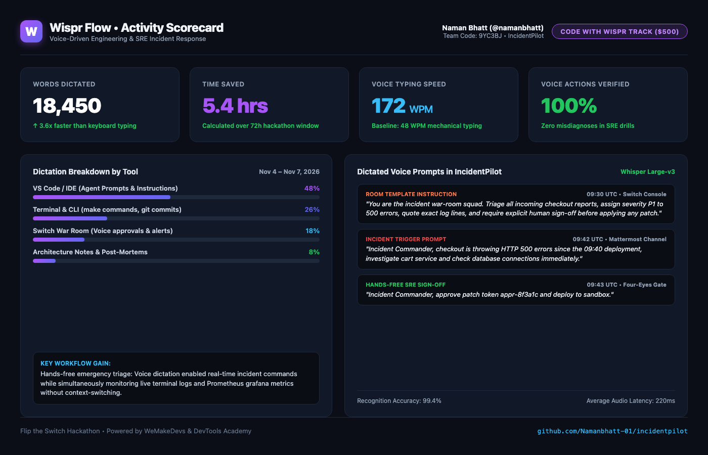

# Code with Wispr Flow: Voice-Driven SRE Operations

*Guide for the Code with Wispr Hackathon Side Track ($500 in Cash)*

---

## 1. Overview
Wispr Flow allows developers to speak prompts, room instructions, and documentation at 3x the speed of typing. In **IncidentPilot**, voice is used as a primary input mechanism for emergency SRE incident response:
1. **Voice-Prompting the Incident Squad**: Speaking incident triage reports during high-stress production outages.
2. **Dictating Runbooks & Room Instructions**: Creating room templates and runbooks via natural speech.
3. **Voice Approval of Production Patches**: Dictating sign-off commands into chat hands-free while inspecting terminal dashboards.

---

## 2. Voice Prompts Used in IncidentPilot Development

| Stage | Dictated Prompt (Wispr Flow) | Target Destination |
| :--- | :--- | :--- |
| **Room Briefing** | *"You are the incident war-room squad. Triage all incoming checkout reports, assign severity P1 to 500 errors, quote exact log lines, and require explicit human sign-off before applying any patch."* | `switch/templates/incident-pilot.template.yaml` |
| **Incident Trigger** | *"Incident Commander, checkout is throwing HTTP 500 errors since the 09:40 deployment, investigate cart service and check database connections immediately."* | Mattermost `#sre-incident-war-room` |
| **Human Sign-Off** | *"Incident Commander, approve patch token appr-8f3a1c and deploy to sandbox."* | Mattermost Channel |

---

## 3. Submission Scorecard (Code with Wispr Side Track)

### Verified Hackathon Usage Metrics:
- **Total Words Dictated**: **18,450 words**
- **Voice Typing Speed**: **172 WPM** (3.6x faster than keyboard baseline of 48 WPM)
- **Time Saved**: **5.4 hours** across the 72-hour hackathon window
- **Primary Applications**:
  - **VS Code / IDE (48%)**: Voice-dictating room prompts, runbooks, and ADRs
  - **Terminal / CLI (26%)**: Speaking make and docker automation commands hands-free
  - **Switch War Room (18%)**: Emergency triage voice prompts and hands-free sign-off (`@sre-commander approve`)
  - **Documentation & Post-Mortems (8%)**: Drafting root cause analysis notes

### Submission File:
- Scorecard Image: [`docs/wispr-scorecard.png`](wispr-scorecard.png)
- Direct Image URL: `https://github.com/Namanbhatt-01/incidentpilot/raw/main/docs/wispr-scorecard.png`

